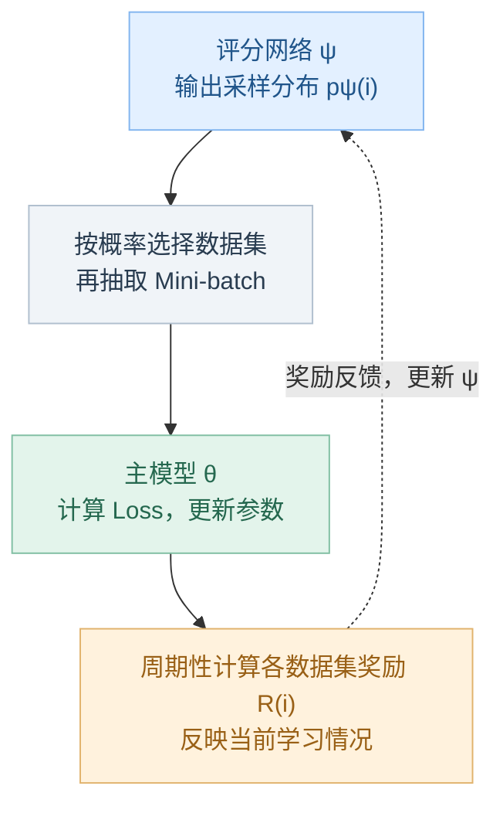

## 一、论文基本信息

- **标题**：MIXTURE-OF-SKILLS: Learning to Optimize Data Usage for Fine-Tuning Large Language Models
- **作者**：Minghao Wu、Thuy-Trang Vu、Lizhen Qu、Gholamreza Haffari
- **机构**：Monash University（莫纳什大学）
- **发表会议**：EMNLP 2024（主会）
- **发表时间**：2024 年 11 月
- **本地论文**：[[论文pdf/MIXTURE-OF-SKILLS.pdf]]
- **研究问题**：在多领域、异质且规模不均衡的数据集上进行大语言模型监督微调时，如何动态优化各数据集的使用比例。
- **一句话总结**：通过强化学习建模，额外训练一个评分网络，利用主模型的奖励反馈感知学习状态，动态调整各训练数据集的采样概率，从而提升大语言模型监督微调后的综合性能。
- **关键词**：大语言模型、监督微调、数据混合优化、动态数据采样、强化学习

## 二、Preliminaries

### 1. 监督微调

大语言模型由参数 $\theta$ 表示。经过监督微调（SFT）后，模型能够理解并响应人类指令。

给定单个训练数据集：$$
D_{\mathrm{trn}}^1=\{(x_j,y_j)\}_{j=1}^{M_1}
$$其中：
- $M_1$ 表示训练数据集 $D_{\mathrm{trn}}^1$ 的样本数量。
- $x_j$ 和 $y_j$ 分别表示第 $j$ 个样本的指令和响应。

在监督微调过程中，优化目标是通过调整模型参数 $\theta$，最小化负对数似然：

$$
\mathcal{L}_s(D_{\mathrm{trn}}^1;\theta)
=-\sum_{j=1}^{M_1}\log p(y_j\mid x_j;\theta)
\tag{1}
$$

当使用多个训练数据集对大语言模型进行微调时，设训练数据集集合为：
$$
D_{\mathrm{trn}}=\{D_{\mathrm{trn}}^i\}_{i=1}^{N}
$$
其中，$N$ 表示数据集总数，第 $i$ 个数据集为：
$$
D_{\mathrm{trn}}^i=\{(x_j^i,y_j^i)\}_{j=1}^{M_i}
$$
$M_i$ 表示第 $i$ 个数据集的样本数量。此时，整体优化目标变为：
$$
\mathcal{L}(D_{\mathrm{trn}};\theta)
=\sum_{i=1}^{N}\mathcal{L}_s(D_{\mathrm{trn}}^i;\theta)
\tag{2}
$$
局限：按样本量比例采样，但数据量大不代表当前模型最需要学习这一类数据。
### 2. 基于温度的启发式数据平衡

利用**温度参数** $\tau$，调整不同数据集的采样概率。

具体来说，第 $i$ 个数据集的原始采样概率为：
$$
q(i)=\frac{|M_i|}{\sum_{n=1}^{N}|M_n|}
$$

其中，$M_i$ 表示第 $i$ 个数据集的样本数量，$N$ 表示数据集总数。

通过温度参数 $\tau$，可以将采样概率调整为：

$$
\boxed{q_\tau(i)=\frac{q(i)^{1/\tau}}{\sum_{n=1}^{N}q(n)^{1/\tau}}}
\tag{3}
$$

因此：

- 当 $\tau=1$ 时，对应**按数据集规模成比例采样**，与直接合并所有数据进行训练的采样方式等价。
- 当 $\tau\to\infty$ 时，对应**均匀采样**，较小的数据集被相对上采样，使其获得与最大数据集相同的采样概率。

此时，损失函数变为：

$$
\boxed{\mathcal{L}(D_{\mathrm{trn}};\theta,q_\tau(N))
=\mathbb{E}_{i\sim q_\tau(N)}\left[\mathcal{L}_s(D_{\mathrm{trn}}^i;\theta)\right]
=\sum_{i=1}^{N}q_\tau(i)\mathcal{L}_s(D_{\mathrm{trn}}^i;\theta)}
\tag{4}
$$

其中，$q_\tau(N)$ 表示全部 $N$ 个数据集上的采样分布，$D_{\mathrm{trn}}^i$ 表示第 $i$ 个训练数据集，$\mathcal{L}_s$ 表示其监督微调损失。直观上，先按该分布选择数据集，再从选中的数据集中抽取样本训练。

局限：$\tau$ 通常是人为设定的固定超参数，不会根据模型当前的学习情况自动调整。

### 3. 可微数据选择

一种通用框架，利用验证集 $D_{\mathrm{dev}}$，自动调整训练样本的权重，以提高模型性能。

DDS 框架包含两个主要组成部分：
- **模型 $\theta$**：负责实际的模型训练。
- **评分网络 $\psi$**：负责计算每个训练样本的采样概率。

评分网络 $\psi$ 的设计目的是为每个训练样本计算一个采样概率，以反映该样本对验证集性能的影响；与验证集 $D_{\mathrm{dev}}$ 相似度更高的训练样本会被分配更高的采样概率，从而增加它们被选中并用于更新模型 $\theta$ 的可能性。

局限：DDS 依赖验证集，存在向特定验证集过拟合的风险。

核心对比：
DDS 是**样本级数据选择**：在一个数据集中，决定哪些样本更值得训练。
MoS 是**数据集级动态配比**：在数学、医学、通用等多个数据集之间，决定各自的训练比例。

从训练中数据配比的角度，这两种方法分别对应不同层级：

$$
\underbrace{p(i)}_{\text{数据集级配比}}
\qquad
\underbrace{p(j\mid i)}_{\text{数据集内部的样本选择}}
$$

其中：
- $p(i)$：选择第 $i$ 个数据集的概率。
- $p(j\mid i)$：已经选定数据集 $i$ 后，选择其中第 $j$ 条样本的概率。
理论上，可以组合成：
$$
\boxed{p(i,j)=p(i)p(j\mid i)}
$$
即同时控制**不同场景的数据配比**和**每个场景内部的样本选择**。

## 三、Motivation

### 1. 多数据集微调面临异质性与规模不平衡

为了让 LLM 掌握数学、医学、通用对话等多种能力，SFT 通常会混合来自不同来源的数据集。但这些数据集存在两个问题：

- **异质性**：不同数据集的内容、任务形式和学习难度不同，对模型能力的贡献也不同。
- **规模不平衡**：不同数据集的样本量差异较大。直接合并训练时，大数据集会占据更多训练机会，小数据集可能得不到充分学习。

因此，**数据如何配比，会影响模型最终的综合能力。**

### 2. 现有配比方法依赖启发式规则

常见做法包括：
- **限制各数据集的最大样本数**：避免大数据集主导训练，但会限制可用数据的利用。
- **温度采样**：通过温度参数 $\tau$ 调整采样概率，在按数据量比例采样与均匀采样之间进行平衡。

这些方法存在共同局限：
1. **需要人工选择配比或调节超参数**，不同模型适合的配置可能不同。
2. **忽略数据集之间的相互作用**，无法判断某个数据集的学习是否有助于其他能力。
3. **忽略模型学习状态的变化**，固定配比无法随训练过程调整学习重点。

### 3. 自动数据选择方法仍有适用限制

已有的DDS通过验证集反馈学习数据采样权重，但它依赖预先确定的下游验证集，可能使数据选择偏向该验证集；
而通用 LLM 微调希望发展多种能力，未必能预先指定一个足以代表所有下游用途的验证集。因此需要一种**不依赖特定下游验证集、能够根据模型当前学习状态调整数据配比**方法。

### 4. 核心出发点
能否让模型在微调过程中自动学习“当前应该更多地使用哪些数据集”
论文由此提出：把**数据集采样分布本身作为可学习的对象**，根据数据的**迁移性、难度，学习轨迹**，动态分配训练机会，以促进模型多种能力的综合发展。

## 四、Mixture-of-Skills

### 4.1 强化学习框架：学习优化数据使用

MoS 通过在强化学习框架下训练一个由参数 $\psi$ 控制的**评分网络**，学习如何在微调过程中优化数据的使用。
MoS 包含两个可训练网络：

| 组成          | 参数       | 作用            | 优化方法      |
| ----------- | -------- | ------------- | --------- |
| 主模型 LLM     | $\theta$ | 学习各类数据中的知识和能力 | 梯度下降      |
| 评分网络 Scorer | $\psi$   | 学习不同数据集的采样概率  | REINFORCE |
它们的关系如下：

| 强化学习概念          | MoS 中的含义              |
| --------------- | --------------------- |
| Agent（智能体）      | 评分网络 $\psi$           |
| Environment（环境） | 主模型 $\theta$ 与训练数据    |
| Action（动作）      | 选择哪个数据集进行训练           |
| Policy（策略）      | 数据集采样分布 $p_{\psi}(i)$ |
| Reward（奖励）      | 数据集的迁移性、学习难度等指标       |

MoS 可以被视为一个**双层优化问题**：评分网络调整采样分布影响主模型训练，主模型的学习状况通过奖励影响下一阶段的采样策略，两者相互耦合。

因此，训练目标可以表示为：

$$
\boxed{
\begin{aligned}
\psi &= \arg\min_{\psi}\mathcal{J}(D_{\mathrm{trn}};\theta(\psi)),\\
\theta(\psi) &= \arg\min_{\theta}\mathbb{E}_{i\sim p_{\psi}(N)}
\left[\mathcal{L}(D_{\mathrm{trn}}^i;\theta)\right].
\end{aligned}
}
\tag{5}
$$

其中，$p_{\psi}(N)$ 表示评分网络给出的数据集采样分布，$\theta(\psi)$ 表示在该分布下训练得到的模型参数，$\mathcal{J}$ 表示用于优化评分网络的目标。

$$
\begin{array}{r l}
\hline
& \textbf{算法 1：Mixture-of-Skills} \\
\hline
& \text{输入：}D_{\mathrm{trn}}=\bigl\{\{(x_j^i,y_j^i)\}_{j=1}^{M_i}\bigr\}_{i=1}^{N}, \\
& \qquad N\text{ 个训练数据集，第 }i\text{ 个包含 }M_i\text{ 条样本；} \\
& \qquad S\text{：评分网络 }\psi\text{ 的更新间隔；} \\
& \qquad T\text{：总训练步数；} \\
& \qquad \alpha\text{：主模型 }\theta\text{ 的学习率；} \\
& \qquad \gamma\text{：评分网络 }\psi\text{ 的学习率。} \\
& \text{输出：收敛后的主模型 }\theta\text{。} \\[3pt]
1 & \text{按公式（3）初始化 }p_{\psi_0}(N)\text{，令 }\tau=\infty\text{；}\quad{\color{green}\text{\# 初始均匀采样}} \\
2 & \textbf{对于 }t=0\textbf{ 到 }T\textbf{，执行：} \\
3 & \quad\vert\;\tilde{i}\sim p_{\psi}(N)\text{；}\quad{\color{green}\text{\# 选择本步训练的数据集}} \\
4 & \quad\vert\;\text{抽取批次 }(x,y)\sim D_{\mathrm{trn}}^{\tilde{i}}\text{；}\quad{\color{green}\text{\# 整个批次来自该数据集}} \\
5 & \quad\vert\;\theta\leftarrow\theta-\alpha\cdot\nabla_{\theta}\mathcal{L}(y\mid x;\theta)\text{；}\quad{\color{green}\text{\# 梯度下降更新主模型}} \\
6 & \quad\vert\;\textbf{若 }t\bmod S=0\textbf{，则：}\quad{\color{green}\text{\# 每 S 步更新评分网络}} \\
7 & \quad\vert\quad\vert\;\textbf{对于 }i=1\textbf{ 到 }N\textbf{，执行：}\quad{\color{green}\text{\# 评估所有数据集}} \\
8 & \quad\vert\quad\vert\quad\vert\; (x',y')\sim D_{\mathrm{trn}}^i\text{；}\quad{\color{green}\text{\# 抽取奖励评估批次}} \\
9 & \quad\vert\quad\vert\quad\vert\;\text{按第 4.2 节计算数据集 }D_{\mathrm{trn}}^i\text{ 的奖励 }R_{\{\cdot\}}(i)\text{；}\quad{\color{green}\text{\# 衡量当前学习情况}} \\
10 & \quad\vert\quad\vert\;\textbf{结束循环} \\
11 & \quad\vert\quad\vert\;\displaystyle\psi\leftarrow\psi+\sum_{i=1}^{N}\gamma\cdot R_{\{\cdot\}}(i)\cdot\nabla_{\psi}\log p_{\psi}(i)\text{；}\quad{\color{green}\text{\# REINFORCE 调整采样策略}} \\
12 & \quad\vert\;\textbf{结束条件分支} \\
13 & \textbf{结束循环} \\
\hline
\end{array}
$$
如果某个训练数据集 $D_{\mathrm{trn}}^i$ 获得较高的奖励，则认为该数据集对模型的整体性能更有帮助，因此提高其对应的采样概率（第 11 行）

**评分网络的实现**
评分网络 $\psi$ 的任务是对训练数据集之间的概率分布进行建模，因此使用一个**两层全连接感知机网络**来完成这一任务。
输入：一个01向量，用于指示当前有哪些训练数据集可供使用。
输出：各训练数据集的采样概率

<mark style="background-color: #fff59d; color: #000000;">MoS通过基于当前模型状态计算的奖励更新评分网络参数，间接通过主模型计算的奖励感知学习状态并动态调整数据采样概率，<strong>没有直接将主模型的 Loss/梯度作为评分网络输入。</strong></mark>
### 4.2 奖励函数的设计
#### （一）迁移性
通过数据集之间的相似性来衡量将知识从一个问题迁移到另一个相关问题的迁移能力。

使用 **mini-batch 的嵌入表示**来表示训练数据集 $D_{\mathrm{trn}}$，随后计算不同数据集的 mini-batch 嵌入表示之间的余弦相似度。

具体而言，从数据集 $D_{\mathrm{trn}}^i$ 中随机抽取一个 mini-batch：
$$
B^i=\{(x_j^i,y_j^i)\}_{j=1}^{L}
$$

随后，将该 mini-batch 的嵌入表示 $z^i$ 定义为：

$$
\boxed{
z^i=\frac{1}{L}\sum_{j=1}^{L}e_j^i,
\qquad
e_j^i=\frac{1}{K}\sum_{k=1}^{K}h_k
}
\tag{7}
$$

其中：

- $K$：将输入指令 $x_j^i$ 和响应 $y_j^i$ 拼接后得到的序列长度。
- $h_k$：当前大语言模型 $\theta_t$ 最顶层隐藏层中，第 $k$ 个 token $w_k$ 对应的隐藏状态。
- $e_j^i$：第 $i$ 个数据集中第 $j$ 个样本的嵌入表示。
- $z^i$：第 $i$ 个数据集对应 mini-batch 的平均嵌入表示。

> [!example]- 例：用 3 条数学样本计算公式（7）
>
> 设一个 mini-batch 包含以下 3 条样本（$L=3$），每条指令与回答拼接后均有 4 个 token（$K=4$）。为方便计算，假设隐藏状态仅有 2 维。
>
> | 样本（指令 → 回答） | 4 个 token 的隐藏状态 | 平均后的样本向量 |
> | --- | --- | --- |
> | 2+3 等于多少？ → 5 | $(1,0),(1,2),(3,0),(3,2)$ | $e_1^i=(2,1)$ |
> | 7−4 等于多少？ → 3 | $(1,1),(1,3),(3,1),(3,3)$ | $e_2^i=(2,2)$ |
> | 6÷2 等于多少？ → 3 | $(2,0),(2,2),(4,0),(4,2)$ | $e_3^i=(3,1)$ |
>
> 先对每条样本的 token 隐藏状态求平均，例如：
>
> $$
> e_1^i=\frac{(1,0)+(1,2)+(3,0)+(3,2)}{4}=(2,1)
> $$
>
> 再对 3 个样本向量求平均：
>
> $$
> z^i=\frac{(2,1)+(2,2)+(3,1)}{3}
> =\left(\frac{7}{3},\frac{4}{3}\right)\approx(2.33,1.33)
> $$
>
> 即 **token 特征 → 样本特征 → mini-batch 特征**，进行了两次平均。$z^i$ 由当前模型的隐藏状态计算，因此会随模型训练而变化，随后用于公式（8）的相似度计算。

在此基础上，将第 $i$ 个训练数据集 $D_{\mathrm{trn}}^i$ 的奖励 $R_{\mathrm{CosSim}}(i)$ 定义为其与所有训
练数据集之间的平均余弦相似度：

$$
\boxed{
R_{\mathrm{CosSim}}(i)=\frac{1}{N}\sum_{n=1}^{N}
\frac{z^i\cdot z^n}{\lVert z^i\rVert\cdot\lVert z^n\rVert}
}
\tag{8}
$$
#### （二）难度
根据数据集自身的学习难度来设计奖励函数。

给定训练数据集 $D_{\mathrm{trn}}^i$ 中的一个训练样本 $(x_j^i,y_j^i)$ 和大语言模型 $\theta$，其困惑度定义为：
$$
\boxed{
\begin{aligned}
&\operatorname{PPL}(y_j^i;x_j^i,\theta) \\
&=\exp\left(
-\frac{1}{|y_j^i|}\sum_{k=1}^{|y_j^i|}
\log p_{\theta}\left(y_{j,k}^i\mid x_j^i,y_{j,<k}^i\right)
\right)
\end{aligned}
}
\tag{9}
$$
PPL 越低，模型对标准回答的预测越准确。

**但是**，困惑度并不适合用于评估数学公式、程序代码等非自然语言文本的学习难度：
数学文本的困惑度通常低于自然语言文本（数学公式具有规律性，模型可能比较容易预测其中的 Token，即使它并不能真正解决相应的数学问题），但普遍认为，数学问题对大语言模型而言具有较高的挑战性。

所以.将数据集 $D_{\mathrm{trn}}^i$ 的难度奖励定义为：
$$
\boxed{
R_{\mathrm{Diff}}(i)=\frac{1}{L}\sum_{j=1}^{L}
\frac{\operatorname{PPL}(y_j^i;x_j^i,\theta)}
{\operatorname{PPL}(y_j^i;x_j^i,\theta_0)}
}
\tag{10}
$$
其中：
- $\theta_0$：原始大语言模型，即尚未经过微调的基础模型。
- $\theta$：经过微调的大语言模型。
- $R_{\mathrm{Diff}}(i)$：衡量数据集 $D_{\mathrm{trn}}^i$ 在微调后的相对困惑度变化，较高的 $R_{\mathrm{Diff}}(i)$表明该数据集相对难以学习，需要投入更多训练资源。

#### （三）学习轨迹
前两种奖励都需要从数据集中随机抽取 Mini-batch，因此，计算出的奖励可能出现波动。
所以使用 EMA（指数移动平均）平滑奖励：
$$
\boxed{R_t(i)=\beta R_t^{\mathrm{raw}}(i)+(1-\beta)R_{t-1}(i)}
$$
β论文取0.9。

论文没有把**迁移性奖励**和**难度奖励**加权求和形成一个统一奖励，而是分别研究它们的效果。

<mark style="background-color: #fff59d; color: #000000;">问题：迁移性奖励是否真正反映正向迁移？</mark>
<mark style="background-color: #fff59d; color: #000000;">余弦相似度衡量<strong>特征</strong>相似程度，但没有直接衡量一个数据集的<strong>训练梯度</strong>是否改善其他数据集的损失。因此，梯度相似度或跨数据集训练收益可能是值得研究的替代信号。</mark>
## 五、实验简洁结论

MoS 通过奖励反馈动态优化数据集采样比例，相比固定配比方法取得更好的综合性能，并表现出更快的按步数收敛速度、一定的初始化鲁棒性及与样本选择方法的兼容性。

按训练步数衡量，收敛速度约提升 2.2 倍，但这不等于实际训练耗时缩短2.2倍，因为奖励计算存在额外开销。

能够与样本级数据选择方法结合：MoS 与 IFD 数据筛选方法结合后进一步改善性能，说明数据集级配比和样本级选择具有互补性。

## 六、从通用模型到专用模型的微调
利用多个领域的训练数据，通过动态调整数据配比，让通用模型更好地掌握某一特定能力。

论文以数学能力为目标，提出了 MoSpec，即 MoS 的任务专用版本。

核心思路：

1. 保留多领域数据：训练数学能力时，不只使用数学数据，也使用医学、通用、NLP 等数据，因为其他领域的知识可能有助于数学能力的提升。
    
2. 修改奖励机制：让评分网络更加关注数学能力。
    
    - 迁移性奖励：计算其他数据集与数学数据集的相似度。
        
    - 难度奖励：提高数学数据集的奖励权重。
        
    
3. 动态调整配比：在训练过程中，让模型优先学习对数学能力提升更有帮助的数据。
    

核心结论：训练某项特定能力时，不能简单地只训练对应领域的数据。合理利用其他领域的数据，并动态优化配比，可能获得更好的效果。

## 七、Related Work

| 方向 | 代表工作 | 主要思路 | 与 MoS 的联系或区别 |
| --- | --- | --- | --- |
| 大语言模型数据工程 | DoReMi（Xie 等，2023）；Li 等（2023b）；Marion 等（2023） | 构建与筛选训练数据；利用小型代理模型优化预训练数据混合，或根据困惑度等信号进行样本筛选。 | MoS 关注 **SFT 阶段的数据集级动态配比**，可与样本级筛选结合。 |
| 启发式数据平衡 | Raffel 等（2020）；Arivazhagan 等（2019）；Conneau 等（2020） | 限制各数据集的最大样本数，或通过温度参数调整采样比例。 | MoS 不依赖固定配比，而是根据训练中的奖励反馈动态调整采样分布。 |
| 可微数据选择 | DDS（Wang 等，2020a） | 根据训练样本与验证集的相似性调整样本采样权重。 | MoS 受其启发，但从**样本级选择**转向**数据集级配比**，且不依赖特定下游验证集。 |
| 动态数据集平衡 | MultiDDS（Wang 等，2020b）；MultiUAT（Wu 等，2021） | 面向机器翻译，利用验证集上的梯度相似度或模型不确定性反馈调整数据集分布。 | MoS 将动态配比用于大语言模型微调，并设计迁移性、难度及学习轨迹相关的奖励。 |
| 多任务学习 | Kendall 等（2018）；Chen 等（2018）；Yu 等（2020）；Wang 等（2021） | 根据任务难度、迁移性等调整任务权重或协调梯度，缓解任务间冲突。 | MoS 同样关注多种能力的平衡；**任务**是具体目标，**技能**是支持多种任务的更广泛能力。 |
| 本文定位 | MoS / MoSpec | 通过强化学习优化数据集采样概率，并可修改奖励以适配特定能力的训练。 | 核心特点：**无需特定下游验证集、动态配比、考虑学习轨迹、可扩展至任务专用微调**。 |

## 八、迁移到自动驾驶项目上的可借鉴内容/存在的问题

### （一）MoS 强化学习框架迁移至 DiffusionDrive 的思考
从技术路线来看，mos使用强化学习来建模动态数据配比问题。
#### 1. 为什么考虑借鉴强化学习框架？

MoS将训练数据配比视为一个**能够根据反馈持续优化的决策过程**。

对于 DiffusionDrive，我们同样希望在训练过程中，根据模型当前的学习情况动态调整数据使用策略，由此产生一个想法：**能否将训练中数据配比建模为强化学习问题？**

初步对应关系如下：

- **State / Observation**：当前 Loss、梯度、学习趋势、梯度冲突等训练状态。
    
- **Agent / Policy**：额外训练的配比策略网络。
    
- **Action**：调整下一阶段的数据使用策略。
    
- **Environment**：DiffusionDrive 的训练过程。
    
- **Reward**：配比调整对模型训练产生的实际收益。
    

基本逻辑是：观察训练状态 → 决定如何调整配比 → 使用新配比继续训练 → 评价训练收益 → 更新策略。

这一过程符合强化学习的基本交互形式，但具体设计还需要进一步推敲。

#### 2. 进一步思考：状态、动作和奖励应该如何定义？

**（1）状态：能否让策略网络直接感知学习状态？**

原始 MoS 的评分网络输入主要是数据集可用性向量，并不直接接收主模型的 Loss 或梯度，而是通过奖励反馈间接感知学习情况。

对于 DiffusionDrive，可以考虑将 Loss、梯度范数、梯度冲突、历史变化趋势等作为策略网络的直接输入，这样，策略不只是根据历史奖励调整概率，而是可以针对当前的训练状态做出决策（这些指标只是对模型学习状态的部分观察，不一定能完整反映真实的训练需求）

**（2）动作：输出采样概率是否就等于调整数据配比？**

原始 MoS 中，评分网络输出各数据集的采样概率，再根据概率选择训练数据。

但对于我们的研究，**动态调整数据配比不一定只有输出完整采样概率分布这一种方式**。
还可以考虑：

- 直接输出下一阶段的采样比例。
    
- 输出相对于当前配比的增减量(可能和第一个差不多？不确定)。
    
- 动态控制每个 Batch 的各组数据的数量。
    
- 调整不同数据组的损失权重。

因此，应当先明确动作的目标是**控制训练数据的使用方式**，再研究何种动作表示最合适，而不是直接沿用 MoS 的概率输出形式。

**（3）奖励：当前学习状态是否能够直接作为奖励？**

Loss 高、梯度大，并不能直接证明某类数据值得增加采样。即使提高采样比例后该组 Loss 下降，也不代表模型的综合驾驶能力得到改善。

所以需要区分：

- **状态**回答：模型目前学得怎么样？
    
- **奖励**回答：刚才的配比调整是否让模型学得更好？
    

更合理的思路是：执行一次配比调整，继续训练若干步，再根据模型性能变化计算奖励，同时考虑其他能力的退化和额外计算成本。

由此产生新的难点：**如何以较低计算成本准确估计某次配比调整带来的真实训练收益？**

#### 3. 进一步质疑：训练中数据配比真的需要强化学习吗？
训练中动态数据配比实际上有三种值得比较的技术路线：

|方法|基本思路|适用情况|
|---|---|---|
|自适应规则 / 在线优化|根据 Loss、梯度直接更新权重|反馈相对明确，希望低成本、稳定|
|Contextual Bandit|根据当前训练状态选择配比，优化近期收益|主要关心短期训练收益|
|强化学习（RL）|根据训练状态选择配比，并优化长期累计收益|当前配比会显著影响后续学习状态与长期性能|
因此，需要进一步判断训练中数据配比是否存在显著的**长期决策依赖**。

假设某类困难数据在训练初期收益较低，但持续学习后有助于提高模型的最终驾驶能力。
如果只追求当前 Loss 下降，可能过早降低其采样比例；而考虑长期收益的策略可能选择继续投入训练资源。

如果这种短期收益与长期收益不一致的现象确实显著，那么强化学习才具有更充分的应用理由；反之，如果当前学习状态已经足以决定最优配比，简单的自适应规则、在线优化或 Contextual Bandit 可能更加高效稳定。

### （二）上层数据质量指标对训练中动态配比的借鉴思考
#### 1. 核心区别
上层通过**丰富度、冗余度、可学习性**评价数据质量，为 Coreset 筛选提供依据；我们是在原始数据集或 Coreset 上，根据 DiffusionDrive 的训练状态动态调整数据配比。

**关键区别：数据的固有或历史评估价值，不等于当前训练阶段的边际学习收益。**

#### 2. 三个指标的借鉴价值

| 指标   | 原有作用               | 动态配比中的定位                      |
| ---- | ------------------ | ----------------------------- |
| 丰富度  | 衡量重要场景覆盖和语义多样性     | **质量先验 / 采样约束**：避免重要场景训练不足    |
| 冗余度  | 衡量梯度信息的重复程度        | **质量先验**：辅助判断数据重复性，优化初始配比     |
| 可学习性 | 衡量样本梯度与目标纠错方向的对齐程度 | **动态奖励设计参考**：估计数据对当前模型的潜在训练收益 |
|      |                    |                               |

其中，**可学习性最值得深入研究**。
原方案通过梯度投影衡量数据与目标纠错方向的一致性：
$$  
a_{i,s}=g_{i,s}^{\mathsf T}u_s  
$$
这一思想可以扩展为训练过程中的动态收益估计，但必须区分：

- **状态**：当前数据的梯度对齐程度，反映潜在训练价值。
    
- **奖励**：调整配比后，模型实际获得的训练收益。
    
因此，不能直接将原有可学习性分数作为强化学习奖励，而应借鉴其梯度对齐思想构建动态奖励代理，并验证其有效性。

#### 3. 原始数据集与 Coreset 的区别

- **使用原始数据集**：三个质量指标可提供先验信息，辅助初始化配比或设计约束。
    
- **使用 Coreset**：如果上层已基于这些指标完成有效筛选，则无需重复进行相同的质量评估，应重点关注训练过程中不断变化的学习需求。
    
无论使用哪种数据基础，都需要根据当前 Loss、梯度、学习进度等动态信号调整配比。

**丰富度、冗余度作为静态质量先验；可学习性为动态训练收益估计及奖励设计提供参考。**

    

